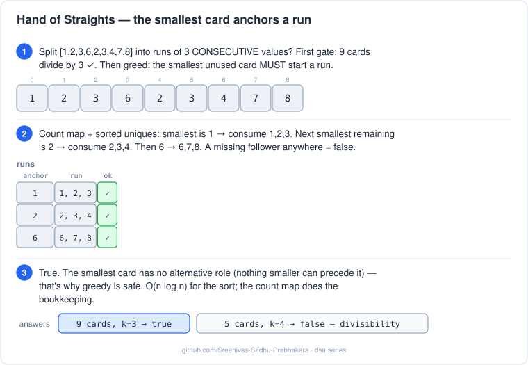

# Hand of Straights

> NeetCode 150 · Greedy — the smallest remaining card has no choice: it must start a group, so consume its whole run at once (all its copies together). Go, stdlib only, tested.

## Problem

Can a hand of cards be rearranged into groups, each exactly groupSize *consecutive* values? `[1,2,3,6,2,3,4,7,8]` in threes → 1-2-3, 2-3-4, 6-7-8.

## Approach

Greedy anchored on a forced move: the smallest card still in hand can't extend any group downward, so it must *start* one — no choice, hence no search. Count cards in a map, walk the distinct values ascending; for each value with c copies remaining, c groups start there, so subtract c from each of the next groupSize consecutive counts, failing when any runs short. Processing all c copies at once (rather than one group at a time) keeps the walk linear in distinct values. The divisibility pre-check (`len % groupSize`) eliminates the impossible before any work.

**Complexity:** O(n log n) time (sorting distinct values), O(n) space.

## Visual walkthrough

Read the picture top to bottom — each numbered frame is one moment of the algorithm
running on this repo's test example.

## Run

    go test ./...   # verify
    go run .        # demo

---

Part of a 275-repo DSA series in Go — Striver's SDE Sheet (dsa-001–191) plus the NeetCode 150 / Blind 75 additions (dsa-192–275), stdlib only, every solution tested. Browse: [`dsa-*` repos](https://github.com/Sreenivas-Sadhu-Prabhakara?tab=repositories&q=dsa-&type=source).
